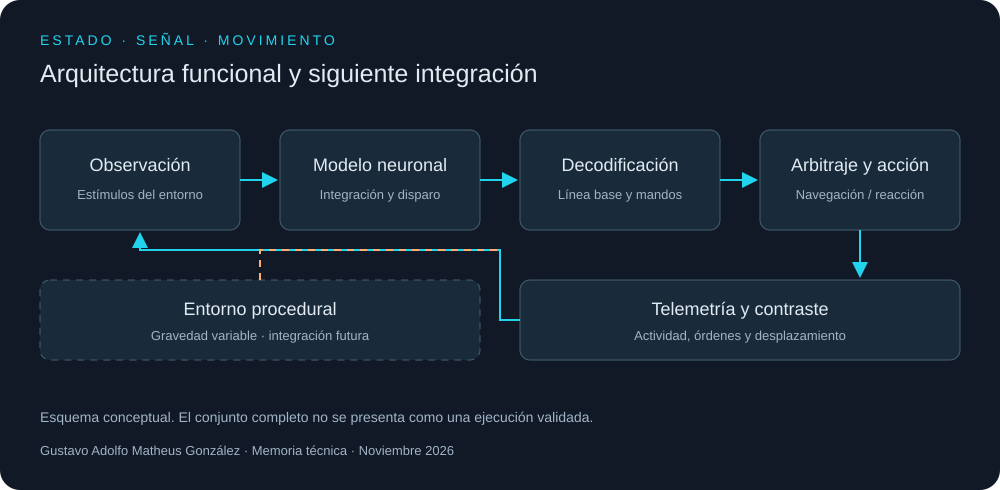
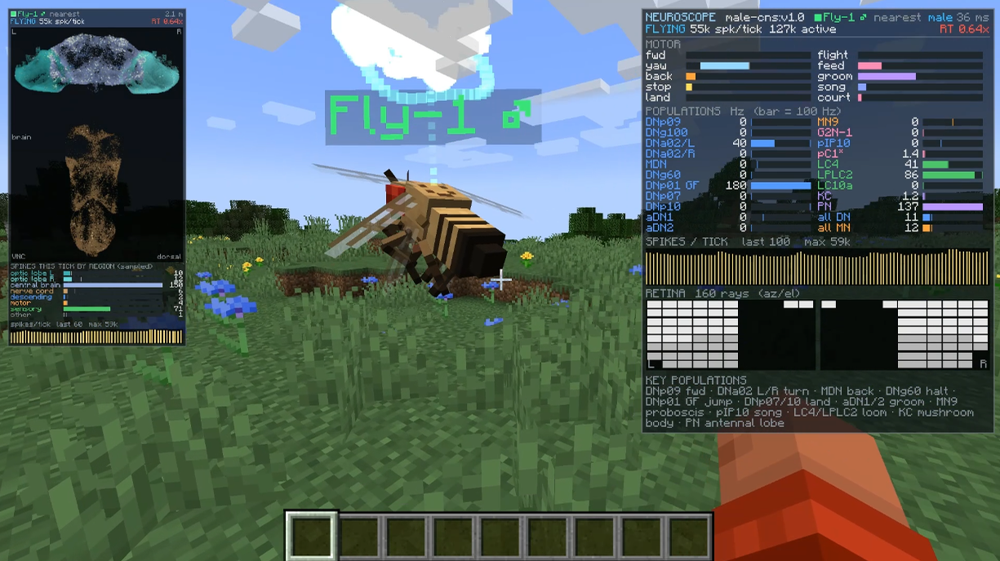
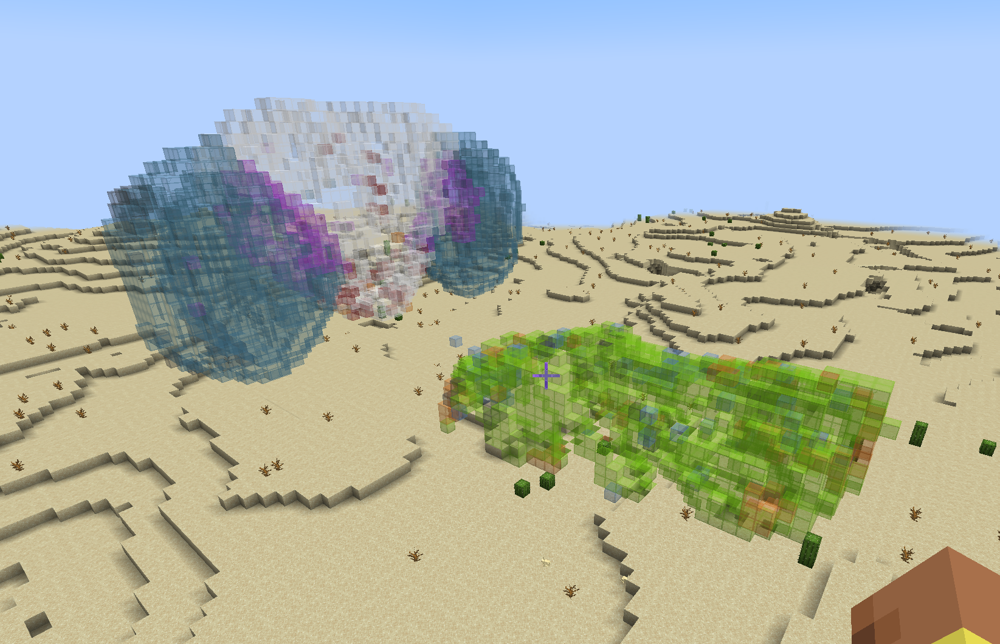
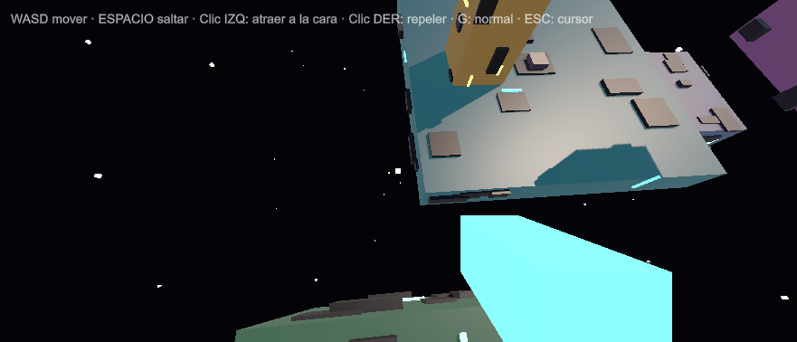

# Dinámica neuronal, control y generación espacial

## Memoria de desarrollo de un banco experimental de simulación y entornos procedurales

**Gustavo Adolfo Matheus González · GMProspect**  
Publicado el 1 de noviembre de 2026. Ensayos de control documentados el 7 de octubre de 2026.

El trabajo reúne dos frentes de desarrollo: un entorno de experimentación con dinámica neuronal y control de agentes, y un subsistema gráfico procedural con navegación sobre superficies de orientación variable. Su relación se encuentra en el tratamiento del estado: cómo se produce una señal, cómo se transforma en una orden y cómo se representa su efecto en un espacio observable.

La memoria los presenta como una misma línea de ingeniería. El alcance actual comprende componentes ejecutables, ensayos de navegación, modificaciones del decodificador motor, visualización de actividad y construcción procedural de escenarios. La integración completa entre todos los entornos continúa como objetivo de desarrollo.

*Figura 1. Organización funcional. Las flechas representan el recorrido de información propuesto; la unión con el entorno de gravedad variable corresponde a una etapa posterior. El diagrama no acredita una ejecución conjunta de todos los componentes.*

## 1. Reconstrucción y representación

El primer frente utiliza un modelo neuronal de integración y disparo con fuga, asociado a una reconstrucción conectómica de insecto. El estado de cada unidad evoluciona por integración temporal; los impulsos emitidos se propagan por conexiones ponderadas. Las poblaciones sensoriales reciben estímulos del entorno y las poblaciones descendentes alimentan canales de movimiento.

La procedencia local del conjunto MaleCNS registra **176.422 neuronas, 6.287.749 conexiones retenidas y 90.296.905 sinapsis representadas en sus pesos**. Son magnitudes diferentes: una conexión puede agrupar múltiples contactos sinápticos. La preparación conserva enlaces con al menos cinco sinapsis y excluye autoconexiones. Estas cifras describen el conjunto utilizado, no una medición nueva ni una reconstrucción anatómica propia. Fuente: [procedencia del modelo base](https://github.com/blendi-remade/fly-brain-minecraft/blob/main/PROVENANCE.md).

La representación espacial permite inspeccionar regiones y posiciones anatómicas; la telemetría funcional muestra tasas de disparo y canales motores. Una representación visible facilita el diagnóstico, pero no sustituye el registro numérico de un ensayo.

*Figura 2. Imagen de referencia distribuida con el proyecto base: actividad, lecturas motoras y representación sensorial. No es una captura de la corrección local ni evidencia de su resultado. Procedencia: [imagen original](https://github.com/blendi-remade/fly-brain-minecraft/blob/main/docs/media/hud-brainview-neuroscope.png).*

*Figura 3. Representación espacial distribuida con el proyecto base. Ilustra la reconstrucción por bloques; no constituye una medición de densidad sináptica realizada en este trabajo. Procedencia: [imagen original](https://github.com/blendi-remade/fly-brain-minecraft/blob/main/docs/media/flybrain-build.png).*

## 2. Observación de una asimetría motora

Durante los ensayos locales se registró una respuesta lateral desigual en el canal de giro. La estimulación olfativa a igual tasa nominal por neurona produjo actividad sostenida asimétrica en las poblaciones descendentes examinadas y un mando de giro persistente. La observación motivó el análisis del decodificador y de sus condiciones de arranque.

La igualdad de tasas de estimulación no asegura igualdad de entrada bilateral total ni trenes de impulsos idénticos. El análisis estructural aporta hipótesis sobre la propagación, pero no demuestra por sí solo una causa fisiológica. El resultado se trata como un comportamiento del modelo y de su configuración experimental.

Se introdujo una compensación de línea base en la salida de giro, conservando los pesos del conectoma. Su evolución puede expresarse como **dB/dt = (u − B)/τ**, donde u es el mando previo a la compensación, B la línea base y τ una constante de adaptación de 3 s. Tras una fase inicial de 1 s, la salida usa la diferencia entre el mando y su línea base.

La revisión detectó que el promedio inicial incorporaba la rampa de un suavizador. Esa condición sesgaba la calibración aun con una entrada constante. La tercera revisión estima la línea base desde la señal sin suavizar y limita la adaptación al canal investigado. Se añadieron estímulos deterministas de ambos signos y comprobaciones del mando acumulado.

El informe de pruebas conservado registra **14 casos ejecutados, sin fallos ni errores**, el 7 de octubre. La revisión también registra una compilación correcta. El criterio acumulado se expresa en **yaw·s**, la integral temporal de un mando normalizado; convertirlo en ángulo exige aplicar la ganancia de movimiento. No corresponde denominarlo radianes ni certificación formal.

El filtro mantiene dos límites conocidos: atenúa órdenes de giro legítimas si son sostenidas y puede producir una respuesta contraria cuando se retira una entrada persistente. La corrección del arranque está verificada en el decodificador; la trayectoria corporal con y sin adaptación y con distintas capas de reflejos sigue pendiente de comparación controlada.

## 3. Control, navegación y prioridades

El control se organiza en tres niveles funcionales: objetivos de recorrido, ejecución de navegación y señales reflejas derivadas del modelo neuronal. La instrumentación permite consultar el estado del entorno, solicitar desplazamientos y observar las salidas del piloto experimental.

Un ensayo de navegación registró llegada al objetivo en **8,2 s**. Es evidencia de una operación concreta de desplazamiento, bajo la configuración documentada. La atribución del recorrido corresponde al ejecutor de navegación; ese resultado no demuestra que el conectoma resolviera la planificación.

En otra observación, una aproximación rápida produjo eventos de escape lateralizados. Esto permitió explorar una prioridad de reacción sobre el movimiento ordinario. La evaluación pendiente consiste en medir interrupción, recuperación del recorrido y falsas alarmas, relacionando cada cambio corporal con la capa que lo ordenó.

La separación entre actividad neuronal, mando decodificado y desplazamiento efectivo es parte del método. Un canal centrado no garantiza ausencia de rotación cuando existen otros reflejos programados; una llegada tampoco permite atribuir la decisión a todas las capas presentes.

## 4. Motor de escena y construcción procedural

El segundo frente desarrolla un subsistema de generación espacial: un componente construye escenario, iluminación, cámara, jugador, instrumento de interacción y elementos de interfaz durante la ejecución. El recorrido incluye un prototipo bidimensional de cambio de fase y una versión tridimensional de manipulación gravitatoria.

En el prototipo tridimensional, la superficie seleccionada define una dirección de atracción o repulsión. La cámara y el cuerpo se reorientan de forma progresiva respecto de la nueva vertical. El sistema incorpora desplazamiento, salto y recuperación de posición al abandonar el área de juego.

Esta capa procedural concentra la construcción del mundo y su comportamiento en código, sobre un entorno gráfico y físico existente. La evidencia disponible respalda un motor de escena a nivel de aplicación. La documentación reserva las afirmaciones sobre un renderizador independiente, composición de profundidad entre procesos o sincronización submilisegundo para cuando existan implementación y mediciones que las acrediten.

*Figura 4. Captura conservada del prototipo local: estructuras suspendidas, iluminación y cámara en primera persona. Ilustra el entorno procedural; no demuestra una composición entre motores ni una prueba de rendimiento.*

## 5. Relación entre los componentes

En el circuito de control, el entorno produce observaciones; el modelo neuronal las transforma en actividad; el decodificador produce mandos; el árbitro establece prioridades; el ejecutor aplica el movimiento y la telemetría permite comparar la orden con su efecto.

El entorno procedural aporta un espacio controlable para estudiar orientación, superficies y transformaciones de cámara. Su incorporación al mismo circuito exige definir unidades, referencias espaciales, tiempos de actualización y criterios de interrupción. Esta interfaz pertenece al siguiente tramo de integración.

La publicación unifica el propósito y los resultados de ambos frentes sin presentar una conexión futura como un experimento ya realizado.

## 6. Estado de la evidencia

| Componente | Resultado documentado | Alcance pendiente |
| --- | --- | --- |
| Decodificación de giro | Calibración inicial corregida; informe de 14 pruebas sin fallos | Trayectorias comparadas y respuesta a órdenes sostenidas |
| Navegación instrumental | Llegada registrada en 8,2 s en un ensayo | Repeticiones, obstáculos y recuperación |
| Respuesta de escape | Eventos lateralizados observados ante aproximación | Falsas alarmas y arbitraje completo |
| Generación procedural | Código local y captura de un entorno de gravedad variable | Integración con el circuito neuronal |
| Rendimiento neuronal | Registros entre 0,28× y 1,89× tiempo real bajo cargas distintas | Medición conjunta de latencia y rendimiento sostenido |

Las velocidades corresponden a condiciones de estimulación diferentes; no forman una comparación controlada ni garantizan tiempo real en cualquier escena. La compilación y las pruebas citadas son registros conservados de octubre, no una nueva ejecución realizada para esta publicación.

## 7. Continuidad del trabajo

Los siguientes ensayos deben registrar señal de entrada, actividad neuronal, mando previo y posterior al filtro, origen del movimiento y trayectoria final. La comparación debe variar por separado la adaptación, los reflejos y la navegación. Así será posible distinguir la contribución de cada componente y localizar fallos sin confundirlos con propiedades del sistema biológico.

El interés a largo plazo es profundizar en biología computacional y análisis de redes. Una transferencia hacia problemas vasculares requeriría modelos físicos, datos y validación propios; los ensayos descritos aquí se circunscriben a simulación y control experimental.

La integración resulta informativa cuando cada transición puede examinarse: qué se recibió, qué se calculó y qué cambió en el entorno. Conservar esa trazabilidad permite que una limitación se convierta en una pregunta concreta para el siguiente ensayo.

## Procedencia y distribución

La autoría de esta memoria y de la integración local corresponde a Gustavo Adolfo Matheus González. La base neuronal y sus imágenes de referencia proceden de [fly-brain-minecraft](https://github.com/blendi-remade/fly-brain-minecraft); el código base se distribuye bajo MIT y sus datos bajo CC BY 4.0. Los datos anatómicos proceden del proyecto [Male CNS](https://male-cns.janelia.org/), de FlyEM/Janelia y sus instituciones participantes. Las adaptaciones locales descritas no deben atribuirse al proyecto base.

Esta memoria publica descripción funcional, alcance y figuras seleccionadas. La instrumentación operativa y los archivos de trabajo permanecen en las carpetas locales de acceso restringido. La publicación no distribuye código del modelo, datos anatómicos, ejecutables ni manuales operativos. Las cifras de ensayos locales se presentan como resultados documentados; su reproducción independiente requiere los artefactos de ejecución correspondientes.
